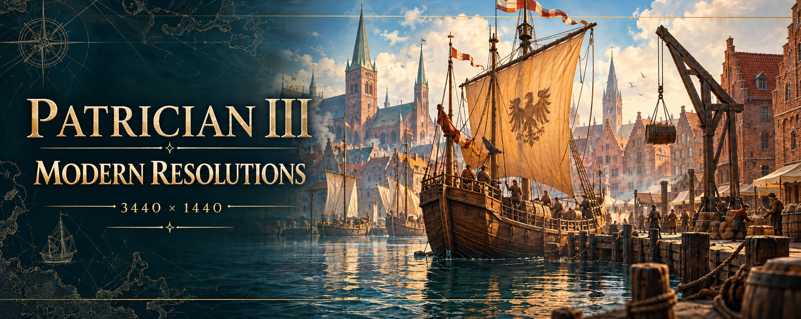

# Patrician III Modern Resolutions

**Classic trading, modern displays.**

A community mod that brings Patrician III to a modern display, with a centered
sea map, correctly proportioned side-panel artwork, and a simple Windows launcher.
This repository contains the patch, its launcher, and the tools used to build
a redistributable package for people who own the game.
The launcher displays this same cover, embedded in the EXE so no external
image file is required to open it.

> **Requirements:** Windows 10/11 and the English Steam edition of Patrician III. Select a resolution in the launcher. The primary display resolution is selected by default when supported.

| Resolution | Validation |
| --- | --- |
| 1920 x 1080 | Confirmed in game by the user |
| 1920 x 1200 | Automated checks passed; gameplay validation pending |
| 2560 x 1080 | Automated checks passed; gameplay validation pending |
| 2560 x 1440 | Automated checks passed; gameplay validation pending |
| 3440 x 1440 | Confirmed in game, including fast-forward |

UI scale remains **100%**. The launcher does not change Windows display settings.

## What it does

| Feature | Result |
| --- | --- |
| Modern display support | The game view uses the selected supported resolution. |
| Centered sea map | At 3440 x 1440, the background stays centered without repetition. |
| Correct side-panel proportions | The original relief and frame are extended without stretching the artwork. |
| Standalone Windows launcher | Finds Steam installations and prepares the mod automatically. |
| Backup and restore | Preserves the original files and lets you return to the standard game. |

The sea map retains its original scale. Narrower profiles keep native sea-map
scrolling; 3440 x 1440 adds neutral space and centering. The main menu keeps
its original dimensions. These profiles do not enlarge text or controls.

## Start playing

### From the release package

1. Extract **Patrician3-Modern-Resolutions-1.1.2.zip** to a folder of your choice.
2. Open **Patrician3ModernResolutions.exe**.
3. Check the detected game folder, or select it with **Browse**, then choose a **Resolution**.
4. With the game closed, click **Launch mod** and approve the Windows UAC prompt.
5. Wait for **Patch active**, then load a game.

**Keep 1280 x 1024 selected in the game options.** This is the original label
of the resolution slot that the patch replaces with the selected resolution.

You do not need Python, a compiler, or a mod loader. The launcher uses the
.NET Framework and PowerShell available on standard Windows 10/11 installations.

### From this repository

Open **Launch-Mod.cmd**. It builds the launcher if necessary, then opens it.
Run **Build.ps1** in PowerShell to create the distributable ZIP in `dist/`.

**Use the launcher for every modded session.** Steam's normal **Play** button
does not apply the runtime patch.

## How it works

The launcher starts the game through Steam and applies the resolution patch
in memory. Required images and INI files are generated locally from the user's
own game installation. The original executables and archives remain unchanged,
and save files are not modified.

The distribution contains the mod's own code, documentation, and original
cover illustration. It does not include proprietary assets extracted from the game.

## Restore the original game

Close the game, open **Patrician3ModernResolutions.exe**, and click **Restore original**.

The initial backup is stored under `mods-ultrawide/backup-originali` inside
the game folder. Keep it: restoring also returns `P2.cfg` preferences to their
first-backup state. These legacy folder names are retained so existing backups
continue to work after the project rename.

## Compatibility and troubleshooting

- The release retains the 1.0.2 fix for the fast-forward sea-map crash investigated
  from a Windows minidump. [Findings and validation](docs/CRASH-2026-10-31.md).
- Requires the verified **English Steam 1.1** build.
- Choose one of the five listed resolutions in the launcher. If the current display resolution is unsupported, select a profile manually.
- Unsupported executable versions or display resolutions are rejected with a message.
- Complete Steam's first launch and **P3Setup** before using the mod.
- Close the game before launching, updating, or restoring the mod.
- Other mods that change the same INI files or images may conflict.
- The executable is not digitally signed; Windows may ask you to verify its source.

Errors appear in the launcher. Its log is at
`%LOCALAPPDATA%/Patrician3ModernResolutions/last-operation.log`.
The runtime-patch log is at `mods-ultrawide/runtime.log` in the game folder.

## Development and distribution

- [Build instructions, implementation details, and tests](docs/DEVELOPMENT.md)
- [Instructions included in the package](QUICKSTART.txt)
- [Release validation](RELEASE-CHECKS.md)
- [Changelog](CHANGELOG.md)

Share the **ZIP produced by the build** together with `SHA256SUMS.txt`.
Keep the game folder, `prepared`, and `backup-originali` private and local.

## Credits

Based on research by brotkohl et al., [Raydell's guide](https://steamcommunity.com/sharedfiles/filedetails/?id=382413909),
[dsedivec's binary-change notes](https://github.com/dsedivec/P3WideScreen/blob/master/binary-changes.txt),
and [P3Modding documentation](https://p3modding.github.io/).
Developed with assistance from OpenAI Codex.

The cover is original **ImageGen** artwork, not a game screenshot. Its project
subtitle was edited while preserving the existing composition.
[Image provenance and prompts](assets/GENERATION.md).
In-game graphics are adapted locally from the user's original game files.

The mod code is available under the [MIT license](LICENSE). The game and its
proprietary assets remain the property of their respective owners.
This is an unofficial community project.
